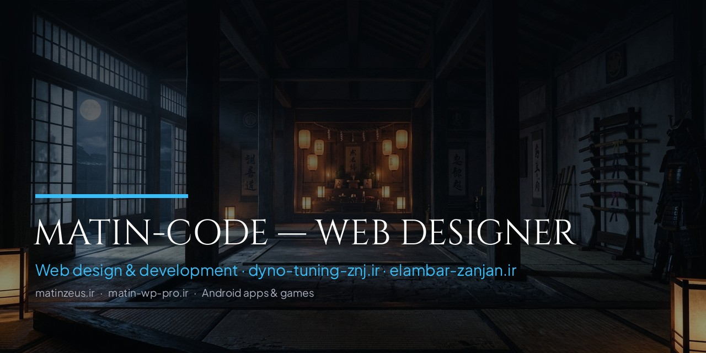

# سلام! من **matin-code** هستم 👋 — Hi, I'm matin-code

**فارسی:** طراح سایت و توسعه‌دهنده وب — طراحی سایت وردپرسی و اختصاصی · اپلیکیشن موبایل · بازی تحت وب
**English:** Web designer & developer — WordPress & custom websites · mobile apps · web games

 

---

## 🌐 وب‌سایت‌های من | My Websites

| | سایت | لینک | توضیح |
|:---:|:---|:---|:---|
| 🏠 | **سایت اصلی** | [**matinzeus.ir**](https://matinzeus.ir) | وب‌سایت رسمی من — خدمات و نمونه‌کارهای طراحی سایت |
| 🛒 | **فروشگاه کانفیگ** | [**matin-wp-pro.ir**](https://matin-wp-pro.ir) | سایت دوم من — فروش کانفیگ |

---

## 💼 من چه کارهایی انجام می‌دم؟ | What I Do

| | خدمت | توضیح |
|:---:|:---|:---|
| 🎨 | **طراحی سایت** | طراحی سایت وردپرسی، شرکتی، فروشگاهی و شخصی |
| ⚡ | **توسعه وب** | HTML · CSS · JavaScript · React · TypeScript |
| 📱 | **اپلیکیشن موبایل** | اپ اندروید و iOS — Java · Swift · Capacitor |
| 🎮 | **بازی‌سازی** | بازی‌های HTML5 تحت وب و موبایل — کاملاً آفلاین |

---

## 🎨 نمونه‌کارهای طراحی سایت | Web Design Portfolio

**سایت‌هایی که طراحی و پیاده‌سازی کردم — Websites I designed & built:**

 

| پروژه | توضیح | لینک |
|:---:|:---|:---:|
| 🏎️ | **داینوجت زنجان — RED LINE DYNO** مرکز تخصصی تیونینگ خودرو، تست دینامو و دیاگ حرفه‌ای | [dyno-tuning-znj.ir](https://dyno-tuning-znj.ir/) |
| 🚚 | **باربری و حمل‌ونقل زنجان** صدور بارنامه و حمل بار به سراسر کشور | [elambar-zanjan.ir](https://elambar-zanjan.ir/) |

 

---

## 🚀 پروژه‌های شاخص | Featured Projects

### 🗓️ [تقویم | TAQVIM](https://github.com/Matin-mohebi/TaqvimCod)
**تقویم شمسی، هجری و میلادی — اندروید، iOS و وب**
اوقات شرعی و قبله‌نما · برنامه‌ریز روزانه · تبدیل سه‌طرفهٔ تاریخ · مناسبت‌های رسمی · کاملاً آفلاین

`Android` `iOS/Swift` `Java` `React` `PWA` · [⬇️ دانلود APK v1.7.1](https://github.com/Matin-mohebi/TaqvimCod/releases/latest) · [🌐 تقویم وب (بدون نصب)](https://matin-mohebi.github.io/TaqvimCod/)

 

### 🥷 [نینجا آراشی ۲: مسیر سایه‌ها](https://github.com/Matin-mohebi/ninja-arashi-2-apk)
**پلتفرمر اکشن نینجا با سبک ظاهری سایه — HTML5 + اندروید**
کاتانا · شوریکن · دَش سایه · مبدل · باس‌فایت · سیستم ارتقا · رابط فارسی

`React 19` `Canvas 2D` `Capacitor 7` `TypeScript` · [⬇️ دانلود APK](https://github.com/Matin-mohebi/ninja-arashi-2-apk/releases/latest) · [▶️ بازی آنلاین](https://matin-mohebi.github.io/ninja-arashi-2-apk/)

---

## 🛠️ تکنولوژی‌ها | Tech Stack

---

## 📊 آمار گیت‌هاب | GitHub Stats

&nbsp;

 

---

## 📞 راه‌های ارتباطی با من | Contact Me

**برای سفارش طراحی سایت و همکاری، از راه‌های زیر در دسترسم:**
**For website design orders & collaboration, reach me via:**

 

| راه ارتباطی | آیدی / شماره | لینک |
|:---:|:---:|:---:|
| ✈️ **تلگرام** | `@matin3620` | [t.me/matin3620](https://t.me/matin3620) |
| 📸 **اینستاگرام** | `@matin_web_site` | [instagram.com/matin_web_site](https://instagram.com/matin_web_site) |
| ☎️ **تلفن** | `09195394891` | [09195394891](tel:09195394891) |
| 🏠 **سایت اصلی** | `matinzeus.ir` | [matinzeus.ir](https://matinzeus.ir) |
| 🛒 **فروشگاه کانفیگ** | `matin-wp-pro.ir` | [matin-wp-pro.ir](https://matin-wp-pro.ir) |

 

---

🐍 **کنتربیوشن گراف من | My contribution graph**

  

**ایده، باگ یا پیشنهادی داری؟** توی ریپوی پروژه‌ها [Issue](https://github.com/Matin-mohebi/ninja-arashi-2-apk/issues) باز کن 💬
Have an idea or found a bug? Open an issue in the project repos!

⭐ اگه پروژه‌ها رو دوست داشتی، استار بده — **Star the projects if you like them**

