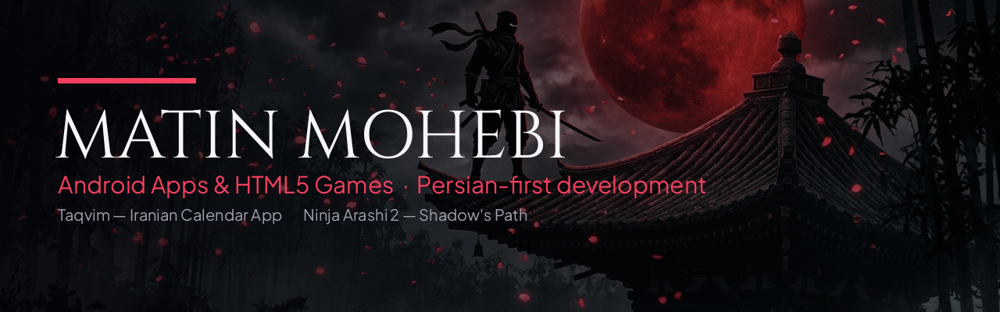

# سلام! من متین هستم 👋 — Hi, I'm Matin

**فارسی:** سازنده اپلیکیشن اندروید و بازی‌های تحت وب — با تمرکز روی محصولات **فارسی‌زبان و آفلاین**
**English:** Android app & web game developer — building **Persian-first, offline-friendly** products

---

---

## 🚀 پروژه‌های شاخص | Featured Projects

### 🗓️ [تقویم | TAQVIM](https://github.com/Matin-mohebi/TaqvimCod)
**تقویم شمسی، هجری و میلادی برای اندروید و iOS**
همگام‌سازی زندهٔ دوطرفهٔ گوگل‌تقویم · اوقات شرعی و قبله‌نما · ویجت · کاملاً آفلاین

`Android` `iOS/Swift` `Kotlin` `PWA` · [⬇️ دانلود APK v1.7.0](https://github.com/Matin-mohebi/TaqvimCod/releases/latest) · [🌐 نسخه وب](https://matin-mohebi.github.io/TaqvimCod/)

 

### 🥷 [نینجا آراشی ۲: مسیر سایه‌ها](https://github.com/Matin-mohebi/ninja-arashi-2-apk)
**پلتفرمر اکشن نینجا با سبک ظاهری سایه — HTML5 + اندروید**
کاتانا · شوریکن · دَش سایه · مبدل · باس‌فایت · سیستم ارتقا · رابط فارسی

`React 19` `Canvas 2D` `Capacitor 7` `TypeScript` · [⬇️ دانلود APK](https://github.com/Matin-mohebi/ninja-arashi-2-apk/releases/latest) · [▶️ بازی آنلاین](https://matin-mohebi.github.io/ninja-arashi-2-apk/)

---

## 🛠️ تکنولوژی‌ها | Tech Stack

---

## 📊 آمار گیت‌هاب | GitHub Stats

&nbsp;

 

---

🐍 **کنتربیوشن گراف من | My contribution graph**

  

**ایده، باگ یا پیشنهادی داری؟** توی ریپوی پروژه‌ها [Issue](https://github.com/Matin-mohebi/ninja-arashi-2-apk/issues) باز کن 💬
Have an idea or found a bug? Open an issue in the project repos!

⭐ اگه پروژه‌ها رو دوست داشتی، استار بده — **Star the projects if you like them**

